<h1 align="center">VectorDB Go</h1>

<p align="center">
  <em>A concurrent, persistent HNSW vector database server in Go, with a checksummed write-ahead log, snapshots, and crash recovery.</em>
</p>

<p align="center">
  <a href="https://github.com/adeoluo/vectordb-go/actions/workflows/ci.yml"></a>
  <a href="https://github.com/adeoluo/vectordb-go/releases"></a>
  
  <a href="LICENSE"></a>
</p>

---

## Motivation

A concurrent, persistent vector database server written in Go. It serves
approximate nearest neighbor search over an HNSW graph (Malkov and Yashunin,
2016), makes every acknowledged write durable through a checksummed
write-ahead log, and restarts from a snapshot plus log replay after a crash.

It is the compiled, durable, concurrent counterpart of the Python HNSW library
([ann-vector-search-library](https://github.com/adeoluo/ann-vector-search-library)):
the same algorithm and the same neighbor selection heuristic, measured on the
same dataset, with persistence and concurrency added.

- **Index:** HNSW with configurable `M`, `efConstruction` and per-query `ef`;
  L2 and cosine; tombstone deletes; safe for concurrent reads and writes
  with per-node locks.
- **Durability:** segmented write-ahead log with CRC-32C framing, three fsync
  policies, group commit, torn-tail detection and truncation, periodic
  snapshots of the full graph, fallback to an older snapshot if the newest is
  damaged.
- **Server:** JSON over `net/http`, named collections with fixed dimension,
  batch upsert, Prometheus `/metrics`, graceful shutdown with a final
  snapshot.
- **Tests:** recall against brute force, a race-detector stress test, and a
  crash test that SIGKILLs a real server process mid-write, damages the log
  tail, restarts, and checks every acknowledged vector bit for bit.

## Architecture

<p align="center">
  
</p>

<sub>Legend: amber = entry points and external systems, indigo = core logic, green = data and state, blue = validation and control, grey = observability and outputs.</sub>

Requests are validated by the HTTP layer and routed to the DB or to a
collection. A write goes to the log first and becomes searchable only after it
is durable and linked into the in-memory HNSW graph. The snapshot policy
triggers consistent snapshots, and startup loads the newest valid snapshot and
replays the log records after it. The benchmark measures recall and throughput
against exact ground truth, and every route is counted in the Prometheus
metrics. Detailed write, snapshot and recovery sequences are in
[docs/ARCHITECTURE.md](docs/ARCHITECTURE.md).

### Concurrency model

Searches never take an index-wide lock. Nodes live in
1024-node chunks whose table is published through an `atomic.Pointer`;
vectors are immutable after allocation; each node has its own `RWMutex`
guarding only its adjacency lists; and a goroutine holds at most one node
lock at a time, so inserts cannot deadlock. Within a collection, a short
write mutex orders log appends and id assignment; the expensive parts (fsync
wait and graph linking) run outside it, so concurrent writers overlap and a
batch is linked in parallel.

### Durability guarantees and limits

What an acknowledged write (HTTP 200 from `upsert` or `delete`) means:

| `--fsync` | Survives SIGKILL / process crash | Survives OS crash or power loss | Cost per durable write |
|---|---|---|---|
| `always` (default) | yes | yes | one fsync, shared by concurrent writers |
| `interval` | yes | all but the last interval | background fsync every 100 ms |
| `never` | yes | only what the OS has flushed | none |

All three policies survive a process crash because each record is written to
the file with one `write(2)` before the request is acknowledged, so it is in
the kernel page cache even if the process dies.

Guarantees:

- A batch is one log record, so after a crash it is applied entirely or not
  at all.
- Records carry dense LSNs inside the CRC-protected payload. Recovery stops
  at the first frame that is short, has an implausible length, fails its
  CRC-32C, or breaks the LSN sequence.
- A bad frame at the end of the last segment (a torn write) is truncated
  away and logged. A bad frame in an earlier segment, or a missing segment,
  stops startup with an error instead of silently dropping data.
- Snapshots are written to a temporary file, fsynced, renamed and the
  directory fsynced. Two are retained and the log is kept back to the older
  one, so a damaged newest snapshot falls back to the previous one.
- If an fsync fails, the collection rejects further writes until restart,
  because the page cache can no longer be trusted.
- A `flock` on `<data-dir>/LOCK` prevents two processes from opening the same
  directory.

Limits:

- **Single node.** No replication. A lost disk loses the data.
- Under `always` on macOS, Go's `File.Sync` uses `F_FULLFSYNC`, measured at
  about 4 ms on the test machine, so a single client sending one vector per
  request gets about 250 writes/s. Batching or concurrency raises this
  (see [server throughput](#durability-and-server-throughput)).
- Corruption in the middle of the active segment is indistinguishable from a
  torn tail and truncates everything after it.
- `GET /vectors/{id}` can observe a new vector a few milliseconds before its
  fsync completes; searches cannot.

## Results

All numbers below were measured on one machine: Apple M1 (4 performance and
4 efficiency cores, 8 GB), macOS 27, Go 1.27.3, Python 3.13, hnswlib 0.8.0,
faiss-cpu 1.15.1, numpy 2.5.4. "8 threads" therefore means 4 fast and 4 slow
cores. Raw results are in [benchmarks/results](benchmarks/results).

### One million real vectors (SIFT1M)

[SIFT1M](http://corpus-texmex.irisa.fr/) is the standard approximate nearest
neighbor benchmark: 1,000,000 real 128-dimensional image descriptors, with its
own queries and exact ground truth, so nothing here is generated. Every library
indexes all one million vectors with `M` 16 and `efConstruction` 200 using all
8 cores, then answers the first 1,000 queries on one thread.

Reproduce: download `ftp://ftp.irisa.fr/local/texmex/corpus/sift.tar.gz`, then
`make build && uv run --project ../ann-vector-search-library python benchmarks/sift1m.py --data sift`.
Raw numbers: [benchmarks/results/sift1m.json](benchmarks/results/sift1m.json).

| Library | Build, 8 threads | ef | Recall@10 | Latency, 1 thread | QPS, 1 thread |
|---|---:|---:|---:|---:|---:|
| FAISS IndexFlatL2 (exact, C++, BLAS) | 0.5 s | exact | 0.999 | 0.930 ms | 1,076 |
| hnswlib (C++) | 155.3 s | 16 | 0.779 | 0.235 ms | 4,260 |
| | | 32 | 0.892 | 0.216 ms | 4,634 |
| | | 64 | 0.960 | 0.372 ms | 2,689 |
| | | 128 | 0.988 | 0.504 ms | 1,984 |
| | | 256 | 0.997 | 0.762 ms | 1,312 |
| **vectordb-go, NEON kernels** | **102.0 s** | 16 | 0.782 | 0.068 ms | 14,731 |
| | | 32 | 0.891 | 0.157 ms | 6,368 |
| | | 64 | 0.957 | 0.187 ms | 5,353 |
| | | 128 | 0.987 | 0.330 ms | 3,025 |
| | | 256 | 0.995 | 0.597 ms | 1,673 |
| vectordb-go, previous portable loop | 166.6 s | 16 | 0.784 | 0.114 ms | 8,730 |
| | | 32 | 0.891 | 0.181 ms | 5,508 |
| | | 64 | 0.958 | 0.302 ms | 3,314 |
| | | 128 | 0.987 | 0.543 ms | 1,842 |
| | | 256 | 0.996 | 0.993 ms | 1,007 |

What this shows, and what it does not:

- **Against its own previous version**, the NEON distance kernels make the
  build 1.6x faster and queries 1.6x to 1.7x faster at identical recall. The
  kernels live in [distance_arm64.s](internal/hnsw/distance_arm64.s); other
  architectures use the portable Go loop.
- **Against hnswlib**, vectordb-go builds the index faster and answers more
  queries per second at every `ef` with the same recall. Read this with care:
  hnswlib's hand-written SIMD distance code targets x86 (SSE and AVX), so on
  this ARM machine its pip wheel computes distances with plain loops. On an x86
  machine with AVX, expect hnswlib to be faster than shown here.
- **Against an exact FAISS scan**, the graph index reaches 0.96 recall at 5x
  the throughput, and 0.99 recall at 3x. The exact scan wins on recall and
  needs no build time.

### Cross-library comparison

[benchmarks/compare.py](benchmarks/compare.py) generates the dataset with the
Python library's own generator (`make_vectors(n, dim, seed=0)`,
`make_queries(200, dim, seed=1)`, the same calls its `compare_libraries.py`
makes), writes it as fvecs, computes exact ground truth in float64, and runs
every library on those exact vectors at matched parameters: `M` 16,
`efConstruction` 200, `ef` 64, `k` 10.

Method notes:

- HNSW libraries are built twice, single threaded and with 8 threads. Recall
  and query numbers come from the single-threaded build, which is
  deterministic.
- hnswlib and FAISS queries are timed as one batched call (`num_threads=1`
  for the single-thread column), so Python call overhead is excluded.
  vectordb-go queries are timed one at a time inside the Go process. The
  Python HNSW library (ann-vector-search-library) is timed one query at a
  time, as it is used.
- "Latency" is mean time per query on one thread.
- The query generator draws a new set of cluster centers (seed 1), so queries
  fall between the base clusters. This is a hard case for graph search and
  is why recall at `ef` 64 drops at 100,000 vectors for both HNSW
  implementations. Held-out in-distribution queries are shown further down.

Reproduce: `make build && uv run --project ../ann-vector-search-library python benchmarks/compare.py --dim 16`.

**10,000 vectors, dim 16**

| Library | Build, 1 thread | Build, 8 threads | Recall@10 | Latency | QPS, 1 thread | QPS, 8 threads |
|---|---:|---:|---:|---:|---:|---:|
| FAISS IndexFlatL2 (exact, C++) | 0.001 s | 0.001 s | 1.000 | 0.022 ms | 46,118 | 163,974 |
| hnswlib (C++) | 0.515 s | 0.138 s | 0.940 | 0.020 ms | 49,423 | 221,342 |
| **vectordb-go (Go)** | 0.551 s | 0.119 s | 0.931 | 0.025 ms | 39,814 | 189,361 |
| Python HNSW library (ann-vector-search-library) | 17.868 s | n/a | 0.926 | 0.745 ms | 1,343 | n/a |

**100,000 vectors, dim 16**

| Library | Build, 1 thread | Build, 8 threads | Recall@10 | Latency | QPS, 1 thread | QPS, 8 threads |
|---|---:|---:|---:|---:|---:|---:|
| FAISS IndexFlatL2 (exact, C++) | 0.001 s | 0.001 s | 1.000 | 0.200 ms | 4,993 | 17,246 |
| hnswlib (C++) | 8.830 s | 2.026 s | 0.750 | 0.025 ms | 40,689 | 169,448 |
| **vectordb-go (Go)** | 11.648 s | 2.198 s | 0.778 | 0.034 ms | 29,251 | 142,288 |

**10,000 vectors, dim 32**

| Library | Build, 1 thread | Build, 8 threads | Recall@10 | Latency | QPS, 1 thread | QPS, 8 threads |
|---|---:|---:|---:|---:|---:|---:|
| FAISS IndexFlatL2 (exact, C++) | <0.001 s | <0.001 s | 1.000 | 0.030 ms | 33,187 | 100,945 |
| hnswlib (C++) | 0.641 s | 0.152 s | 0.899 | 0.028 ms | 35,456 | 153,005 |
| **vectordb-go (Go)** | 0.645 s | 0.140 s | 0.886 | 0.033 ms | 30,170 | 145,655 |
| Python HNSW library (ann-vector-search-library) | 26.782 s | n/a | 0.902 | 1.213 ms | 825 | n/a |

**100,000 vectors, dim 32**

| Library | Build, 1 thread | Build, 8 threads | Recall@10 | Latency | QPS, 1 thread | QPS, 8 threads |
|---|---:|---:|---:|---:|---:|---:|
| FAISS IndexFlatL2 (exact, C++) | 0.001 s | 0.001 s | 1.000 | 0.369 ms | 2,708 | 9,543 |
| hnswlib (C++) | 13.817 s | 3.139 s | 0.652 | 0.037 ms | 26,752 | 115,184 |
| **vectordb-go (Go)** | 17.234 s | 3.632 s | 0.710 | 0.052 ms | 19,310 | 96,045 |

The Python HNSW library (ann-vector-search-library) was not run at 100,000 vectors: at roughly 1.8 to
2.7 ms per insert, a single-threaded build would take several minutes, and
its own README already documents how it scales.

**Reading the results.**

- **Against the Python HNSW library (ann-vector-search-library)** (same
  algorithm, same data), the Go
  implementation builds 32x faster at dim 16 and 42x faster at dim 32 on
  one thread, and answers queries 30x and 37x faster. This is the gap the
  Python library's README identified; a compiled implementation closes it.
- **Against hnswlib**, recall is within 0.06 in every configuration, higher
  in two and lower in two. Both implement the same neighbor selection
  heuristic; the differences come from different random level assignments.
  Single-thread query latency is 1.2x to 1.4x hnswlib's, and single-thread
  build time is 1.0x to 1.3x. With 8 threads, vectordb-go builds faster than
  hnswlib at 10,000 vectors and within 1.2x at 100,000. The remaining gap is
  consistent with hnswlib's SIMD distance kernels and its fully contiguous
  per-node memory layout; vectordb-go uses scalar Go with a four-way
  unrolled loop and keeps upper-layer links in separate slices.
- **Against FAISS flat**, exact search is competitive at 10,000 vectors with
  batched queries, because a BLAS matrix product over 10,000 rows is cheap.
  At 100,000 vectors HNSW is 6x to 7x faster per query on one thread, at the
  cost of recall.

### Recall versus ef (held-out queries)

`vectordb bench --n 100000 --dim 32 --queries 500 --ef 16,32,64,128,256`:
clustered vectors with queries held out from the same mixture, M 16,
efConstruction 200, index built with 8 goroutines in 3.1 s.

| ef | Recall@10 | Mean latency | p99 latency | QPS, 1 goroutine | QPS, 8 goroutines |
|---:|---:|---:|---:|---:|---:|
| 16 | 0.692 | 0.028 ms | 0.055 ms | 35,311 | 216,492 |
| 32 | 0.858 | 0.047 ms | 0.088 ms | 21,069 | 126,480 |
| 64 | 0.956 | 0.087 ms | 0.161 ms | 11,527 | 68,768 |
| 128 | 0.993 | 0.173 ms | 0.321 ms | 5,766 | 37,418 |
| 256 | 0.998 | 0.316 ms | 0.558 ms | 3,165 | 20,566 |

### Go microbenchmarks

`make bench` (`go test -bench`). Index benchmarks use 10,000 clustered dim-32
vectors, M 16, efConstruction 200, ef 64, k 10.

| Benchmark | Result |
|---|---:|
| `BenchmarkInsert` (1 goroutine) | 85.1 µs/insert |
| `BenchmarkInsertParallel` (8 goroutines) | 17.0 µs/insert |
| `BenchmarkSearch` (1 goroutine) | 35.3 µs/query, 1 alloc |
| `BenchmarkSearchParallel` (8 goroutines) | 8.9 µs/query |
| `BenchmarkAppend/never` (256 B record) | 2.5 µs |
| `BenchmarkAppend/interval` | 2.7 µs |
| `BenchmarkAppend/always` (one writer) | 3.98 ms |
| `BenchmarkAppendParallel` (`always`, 64 writers) | 0.138 ms per append, 31 appends per fsync |

Distance kernel, squared L2 per call (`BenchmarkL2`), NEON versus the portable
loop. Below 32 dimensions the call overhead outweighs the vector width, so the
portable loop is used there.

| Dimensions | Portable Go loop | NEON kernel | Speedup |
|---:|---:|---:|---:|
| 16 | 7.0 ns | 7.9 ns | not used |
| 32 | 12.0 ns | 10.7 ns | 1.1x |
| 128 | 42.2 ns | 18.5 ns | 2.3x |
| 768 | 247.5 ns | 70.4 ns | 3.5x |

### Durability and server throughput

End-to-end over HTTP with `vectordb load` against a local server: 100,000
dim-32 vectors, 8 concurrent clients, then 5,000 searches (k 10, ef 64).

| Workload | `--fsync always` | `--fsync never` |
|---|---:|---:|
| Upsert, batches of 100, 8 clients | 20,878 vectors/s | 23,164 vectors/s |
| Upsert, 1 vector per request, 8 clients | 767 vectors/s | 22,527 vectors/s |
| Upsert, 1 vector per request, 1 client | 246 vectors/s | not measured |
| Search, 8 clients | 19,063 req/s, p50 0.38 ms, p99 1.19 ms | 19,640 req/s |

With batches the server is bound by graph construction and the fsync policy
costs about 10%. With one vector per request it is bound by fsync, and group
commit lets 8 clients reach about 3x the single-client rate.

Recovery time for the same 100,000 vector collection: **49 ms** from a
snapshot, **3.46 s** from log replay alone (1,000 records, graph rebuilt with
parallel linking).

### Relation to ann-vector-search-library

[ann-vector-search-library](https://github.com/adeoluo/ann-vector-search-library)
is the Python HNSW library this project is compared against. Its README
measured it against hnswlib and found matching recall but about 27x slower
queries and 150x slower builds, and listed a compiled backend in its
roadmap. This project is that follow-up:

| | ann-vector-search-library | vectordb-go |
|---|---|---|
| Language | Python | Go |
| Algorithm | HNSW, heuristic neighbor selection | same algorithm and heuristic |
| Parameters | `m`, `ef_construction`, `ef` | same parameters, same values in the benchmark |
| Concurrency | single threaded | concurrent inserts and searches, per-node locks |
| Persistence | in memory | WAL with CRC-32C, snapshots, crash recovery |
| Interface | library and CLI | HTTP server, CLI, Prometheus metrics |
| Shared dataset, 10,000 x dim 16 | recall 0.926, 0.745 ms/query | recall 0.931, 0.025 ms/query |

The comparison script imports the Python library's data generator and index
directly, so both are measured on identical vectors and queries.

## Quickstart

Requires Go 1.24 or later, or Docker. Prebuilt binaries for Linux and macOS
are on the [releases page](https://github.com/adeoluo/vectordb-go/releases).

```sh
git clone https://github.com/adeoluo/vectordb-go
cd vectordb-go
make build
./bin/vectordb serve --data-dir ./data --addr 127.0.0.1:8080
```

In another terminal:

```sh
# Create a collection of 3-dimensional vectors.
curl -s -X POST localhost:8080/v1/collections \
  -d '{"name":"docs","dim":3,"metric":"cosine","m":16,"ef_construction":200}'

# Upsert a batch.
curl -s -X POST localhost:8080/v1/collections/docs/upsert -d '{
  "vectors": [
    {"id": "a", "values": [0.1, 0.9, 0.0]},
    {"id": "b", "values": [0.8, 0.1, 0.1]},
    {"id": "c", "values": [0.2, 0.7, 0.1]}
  ]}'
# {"lsn":1,"upserted":3}

# Search.
curl -s -X POST localhost:8080/v1/collections/docs/search \
  -d '{"vector": [0.1, 0.8, 0.05], "k": 2, "ef": 64}'
# {"results":[{"id":"a","distance":0.00201118},{"id":"c","distance":0.014472485}],"took_ms":0.006}
```

With Docker:

```sh
docker build -t vectordb-go .
docker run -p 8080:8080 -v vectordb-data:/data vectordb-go
```

## Usage

A real run of the built-in benchmark: 20,000 clustered vectors, recall@10 and latency per `ef`, and throughput with one and eight goroutines. Regenerate with `vhs docs/demo/bench.tape`.

<p align="center">
  
</p>

### Command line

```
vectordb serve --data-dir DIR [flags]   run the HTTP server
vectordb bench [flags]                  measure build time, recall and latency in process
vectordb load --url URL [flags]         drive a running server over HTTP
vectordb version
```

Main `serve` flags:

| Flag | Default | Meaning |
|---|---|---|
| `--data-dir` | required | collections, logs and snapshots |
| `--addr` | `127.0.0.1:8080` | listen address |
| `--fsync` | `always` | `always`, `interval` or `never` (see below) |
| `--fsync-interval` | `100ms` | period for `--fsync interval` |
| `--snapshot-interval` | `5m` | snapshot when this much time has passed and there are new writes |
| `--snapshot-wal-bytes` | `256MiB` | snapshot after this many log bytes |
| `--snapshot-on-close` | `true` | snapshot during graceful shutdown |
| `--wal-segment-bytes` | `64MiB` | rotate log segments at this size |
| `--shutdown-timeout` | `15s` | time allowed for in-flight requests on SIGTERM |

### HTTP API

All bodies are JSON. Errors return `{"error": "..."}` with 400 (invalid
input), 404 (unknown collection or id), 409 (collection exists), 413 (body
over 64 MiB) or 503 (collection closing). Unknown JSON fields are rejected.

| Method and path | Body | Response |
|---|---|---|
| `GET /health` | | `{"status":"ok"}` |
| `GET /metrics` | | Prometheus text format |
| `GET /v1/collections` | | `{"collections":[stats...]}` |
| `POST /v1/collections` | `{"name","dim","metric","m","ef_construction"}` | 201, stats |
| `GET /v1/collections/{name}` | | stats |
| `DELETE /v1/collections/{name}` | | `{"dropped":true}` |
| `POST /v1/collections/{name}/upsert` | `{"vectors":[{"id","values"}]}` | `{"upserted","lsn"}` |
| `POST /v1/collections/{name}/delete` | `{"ids":[...]}` | `{"deleted","lsn"}` |
| `POST /v1/collections/{name}/search` | `{"vector","k","ef"}` | `{"results":[{"id","distance"}],"took_ms"}` |
| `GET /v1/collections/{name}/vectors/{id}` | | `{"id","values"}` |
| `POST /v1/collections/{name}/snapshot` | | `{"snapshot_lsn"}` |

Details:

- **Collections.** `name` matches `[A-Za-z0-9][A-Za-z0-9_-]{0,63}`. `dim` is
  1 to 65536. `metric` is `l2` (default) or `cosine`. `m` defaults to 16
  (range 2 to 256) and `ef_construction` to 200. All are fixed at creation.
- **Upsert.** 1 to 10,000 vectors per request. Ids are 1 to 512 bytes.
  Values must be finite. An existing id is replaced (the old node is
  tombstoned). Within a batch the last occurrence of an id wins.
- **Delete.** Tombstones the ids. Missing ids are ignored; `deleted` counts
  the ones that existed.
- **Search.** `k` is 1 to 1000 (default 10). `ef` is the search beam width;
  0 or omitted means `max(64, k)`. Distances are Euclidean for `l2` and
  `1 - cosine similarity` for `cosine`.
- **Get.** For `cosine` collections the stored vector is the normalized input.
- **Stats** include `vectors`, `tombstones`, `last_lsn`, `snapshot_lsn`,
  `wal_segments`, `wal_fsyncs`, and a `recovery` object with the snapshot LSN
  used at startup, records replayed, bytes truncated and time taken.

Metrics: `vectordb_http_requests_total{route,code}`,
`vectordb_http_request_duration_seconds` (histogram per route), and per
collection `vectordb_collection_vectors`, `_tombstones`, `_last_lsn`,
`_snapshot_lsn`, `_wal_segments`, `vectordb_wal_bytes_written_total`,
`vectordb_wal_fsyncs_total`, `vectordb_snapshots_total`,
`vectordb_upserts_total`, `vectordb_deletes_total`,
`vectordb_searches_total`, `vectordb_recovery_replayed_records`,
`vectordb_recovery_truncated_bytes`, plus uptime, goroutines and heap size.

### Demos

Recorded from real runs with [vhs](https://github.com/charmbracelet/vhs); each tape is in `docs/demo/`.

Creating a collection, upserting vectors, and searching over the HTTP API.

<p align="center">
  
</p>

The benchmark with cosine distance on 64-dimensional vectors.

<p align="center">
  
</p>

## Design decisions

Design decisions are recorded as ADRs in [docs/adr](docs/adr/):

- [0001: per-node locks and an atomically published node table](docs/adr/0001-locking-strategy.md)
- [0002: WAL record format with CRC-32C and dense LSNs](docs/adr/0002-wal-format.md)
- [0003: snapshots of the full graph plus WAL replay](docs/adr/0003-snapshot-and-replay.md)
- [0004: chunked contiguous storage](docs/adr/0004-chunked-storage.md)

## Testing

```sh
make all     # gofmt check, go vet, go test -race, build
```

CI runs the same steps on every push and pull request, builds and probes the
Docker image, and runs CodeQL.

| Test | What it checks |
|---|---|
| `hnsw.TestRecallAgainstBruteForce` | recall@10 at least 0.95 against exact search (uniform L2, clustered L2, cosine) |
| `hnsw.TestConcurrentInsertAndSearch` | 8 writers and 8 readers on one index under `-race`, then recall at least 0.95 |
| `hnsw.TestEncodeRoundTrip` | snapshot encoding round trip gives identical results and identical bytes; truncated input is rejected |
| `wal.TestTornTailIsTruncated` | partial final record at five cut points is dropped; earlier records kept; appends continue |
| `wal.TestChecksumCorruption` | a flipped payload bit is caught by CRC-32C |
| `wal.TestCorruptionInEarlierSegmentIsAnError`, `TestMissingSegmentIsAnError` | damage to rotated data stops startup |
| `wal.TestGroupCommitDurability` | 16 concurrent writers share fsyncs and every record replays |
| `db.TestSnapshotReplayEquivalence` | snapshot only, snapshot plus replay, and replay only recover identical contents; snapshot restore gives identical search results |
| `db.TestCorruptSnapshotFallsBack` | a damaged newest snapshot falls back to the older one plus replay |
| `db.TestConcurrentWritesSearchesAndSnapshots` | writers, deleters, readers and background snapshots under `-race` |
| `cli.TestCrashRecovery` | see below |
| `server.TestAPI` | every endpoint, status codes, metrics output |

**Crash-recovery test.** The test binary re-executes itself as the server
(`os/exec`), so a real process is killed. With `--fsync always` and
snapshots every 300 ms, four goroutines upsert batches of 10 vectors whose
values are derived from their ids. After 1.5 s the server receives SIGKILL
with requests in flight. The test then appends a damaged record to the
active log segment (a half-written record in round one, a full record with a
bad checksum in round two), restarts the server on the same directory, and
fetches every acknowledged id, comparing all float32 values bit for bit. A
final round sends SIGTERM and checks that the restart needs no replay. A
typical run:

```
round 0 (partial-record): 5060 acked this round, 5060 total; server has 5060 vectors;
  recovered from snapshot LSN 386, replayed 120 records, truncated 29 bytes
round 1 (bad-checksum): 4790 acked this round, 9850 total; server has 9860 vectors;
  recovered from snapshot LSN 848, replayed 138 records, truncated 58 bytes
```

Every acknowledged vector was present with identical values in both rounds.
In round two the server holds one batch more than was acknowledged: it
reached the log just before the kill, but its response was never received.
That is allowed. Fewer would be a failure.

## Limitations

- Single node, single process. No replication, sharding or authentication.
  Put it behind a proxy that adds TLS and auth if exposed.
- The whole index lives in memory: roughly `4 * dim + 4 * (2M + 1)` bytes per
  vector plus upper layers and ids.
- Deletes are tombstones. The graph routes through deleted nodes, and they
  are not reclaimed, so a collection with heavy churn slowly grows.
- No metadata filtering, hybrid search, or quantization.
- SIMD distance kernels exist for arm64 (NEON) only; on x86 the portable Go
  loop is used, and hnswlib's AVX kernels are faster there.
- Corruption in the middle of the active log segment truncates everything
  after it.
- Write throughput per collection with `--fsync always` is bounded by the
  device's fsync latency; group commit amortizes it across concurrent
  writers but not across sequential ones.

## Roadmap

- Compaction: rebuild a collection without tombstones in the background and
  swap it in.
- Payload metadata with filtered search.
- Segment footers or a checksum chain to tell a torn tail from mid-log
  corruption.
- AVX2 distance kernels for amd64, matching the arm64 NEON kernels.
- Scalar quantization (int8) to cut memory by 4x.
- Streaming snapshots so a snapshot does not need a full in-memory copy.
- Read replicas fed by WAL shipping.

## License

Released under the [MIT License](LICENSE).
