<h1 align="center">VectorDB Go</h1>

<p align="center">
  <em>A vector database server written in Go that quickly finds the stored vectors closest to a query and keeps every confirmed write when the server process crashes.</em>
</p>

<p align="center">
  <a href="https://github.com/adeoluo/vectordb-go/actions/workflows/ci.yml"></a>
  <a href="https://github.com/adeoluo/vectordb-go/releases"></a>
  
  <a href="LICENSE"></a>
</p>

---

> **Evidence level: publicly benchmarked.** Search accuracy (recall) and speed (latency) were measured on SIFT1M, a public set of one million vectors. They were compared with FAISS and hnswlib (two widely used C++ search libraries) on a single Apple M1 laptop. Recovery from the write-ahead log is covered by tests that kill the server process. No one else has reproduced the results, and the server has not been used in production.

## Highlights

A vector is a list of numbers that stands for a piece of text, an image or another item.
Similar items have vectors that lie close together. A vector database stores vectors and
quickly finds the ones closest to a query vector. This project is a vector database server
written in Go, and it keeps confirmed data after a crash of the server process.

- **It keeps every confirmed write when the server process is killed.** A test kills the
  real server with SIGKILL (a signal that stops a process at once) while writes are in
  progress. It then appends a damaged record to the end of the log file, restarts the
  server, and checks every confirmed vector bit for bit.
- **It answers more queries per second than hnswlib on one million vectors, on an Arm
  laptop.** On SIFT1M, it answers 1.3 to 2.0 times as many queries per second as hnswlib
  for search widths `ef` 32 to 256. Its recall (share of the true 10 nearest neighbors
  found, from 0 to 1, higher is better) is at most 0.003 below hnswlib's.
- **It is much faster than checking every stored vector.** The comparison is an exact
  scan with FAISS (Meta's similarity-search library), which checks every vector. The index
  finds 96% of the true nearest neighbors at 5 times the scan's query rate, and 99% of
  them at 3 times the rate.

**Where it falls short:** the speed gain over hnswlib was measured only on an Arm laptop
(Apple M1). hnswlib's fastest distance code is written for Intel and AMD (x86) chips, so
hnswlib is expected to be faster on those chips. All timings come from one machine. The
server runs on one machine only, with no copies of the data elsewhere.

## Key terms

Plain definitions of the terms used in this README.

| Term | Meaning |
|---|---|
| Approximate nearest neighbor (ANN) search | Finding the stored vectors closest to a query without comparing it with every stored vector. It is much faster than exact search but can miss some true neighbors. |
| Arm and x86 | Two families of computer chips. Arm (arm64) chips include the Apple M1 used here. x86 (amd64) chips are made by Intel and AMD. |
| BLAS | A standard library of fast matrix and vector math. FAISS uses it for its exact scan. |
| `ef` | Search width: how many candidate vectors HNSW keeps while searching. A larger `ef` gives higher recall but slower queries. |
| `efConstruction` | The search width used while building the graph. A larger value gives a better graph but a slower build. |
| Exact search | Comparing the query with every stored vector (also called brute force). It is slower than ANN search on large data but has the highest recall. |
| FAISS | Meta's similarity-search library, written in C++. Here only its exact scan (IndexFlatL2) is used, as a reference point. |
| fsync | An operating system call that forces data from memory onto the disk, so the data survives a power loss. It is slow compared with a normal write. |
| Group commit | Several writers that wait at the same time share one fsync, instead of each paying for its own. |
| HNSW | Hierarchical Navigable Small World: a search method that links vectors into a layered graph and walks the graph toward the query (Malkov and Yashunin, 2016). |
| hnswlib | A popular C++ library for HNSW search. It is the main speed comparison here. |
| Latency | Time to answer one query, in milliseconds (ms) or microseconds (µs). Lower is better. p50 and p99 are the times within which 50% and 99% of queries finish. |
| Log sequence number (LSN) | A number given to each log record. Numbers rise by one with each record, so a gap shows that a record is missing. |
| `M` | How many links each node in the HNSW graph keeps. More links give higher recall but use more memory and build time. |
| NEON | The SIMD instructions of Arm chips. This project has hand-written NEON code for distance calculations. |
| Queries per second (QPS) | How many queries are answered per second. Higher is better. |
| Recall@10 | The share of the true 10 nearest neighbors that a search returns, from 0 to 1. Higher is better. |
| SIFT1M | A standard public test set: one million real image descriptors of 128 numbers each, with its own queries and their exact answers. |
| SIMD | Chip instructions that process several numbers at once. SSE and AVX are the x86 versions. NEON is the Arm version. |
| Snapshot | A full copy of a collection's graph saved to disk. After a crash, the server loads it and then replays only newer log records. |
| Tombstone | A mark that says a vector is deleted. The vector is skipped in results but not removed from memory. |
| Torn write | A record only partly written to disk because the process or machine stopped in the middle of the write. |
| Vector | A list of numbers that stands for an item, such as a piece of text or an image. Similar items have vectors that lie close together. |
| Vector database | A database that stores vectors and finds the ones closest to a query vector. |
| Write-ahead log (WAL) | A file to which every change is added before it is applied. After a crash, the server replays the log to rebuild its state. |

## Motivation

This project is a vector database server written in Go. It handles many requests at the
same time and stores its data on disk. It answers approximate nearest neighbor searches
with an HNSW graph (Malkov and Yashunin, 2016). Every write that the server confirms is
first made durable in a write-ahead log protected by checksums. After a crash, the server
loads a snapshot and replays the log records written after it.

It is the compiled, durable and concurrent version of the author's Python HNSW library
([ann-vector-search-library](https://github.com/adeoluo/ann-vector-search-library)).
It uses the same algorithm and the same rule for choosing graph neighbors, and it is
measured on the same data. It adds storage on disk and support for many requests at once.

- **Index:** HNSW with settable `M`, `efConstruction` and per-query `ef`. It supports two
  distance measures: L2 (straight-line distance) and cosine (based on the angle between
  vectors). Deletes are tombstones. Reads and writes can run at the same time, because
  each graph node has its own lock.
- **Durability:** the write-ahead log is split into segment files. Each record carries a
  CRC-32C checksum (a short code that detects changed bytes). Three fsync policies set
  when data is forced to disk, and group commit lets writers share an fsync. A torn
  record at the end of the log is detected and cut off. Snapshots of the full graph are
  taken regularly, and if the newest one is damaged, the server falls back to an older one.
- **Server:** JSON requests over HTTP, using Go's standard `net/http` package. Data is kept
  in named collections, each with a fixed vector length (dimension). Vectors can be
  upserted in batches (upsert means insert, or replace if the id exists). Metrics for
  Prometheus (a monitoring system) are at `/metrics`. A graceful shutdown takes a final
  snapshot.
- **Tests:** recall is checked against exact search. A stress test runs under Go's race
  detector (a tool that finds unsafe shared memory access between threads). A crash test
  kills a real server process with SIGKILL during writes and damages the end of the log.
  It then restarts the server and checks every confirmed vector bit for bit.

## Architecture

<p align="center">
  
</p>

<sub>Legend: amber = entry points and external systems, indigo = core logic, green = data and state, blue = validation and control, grey = observability and outputs.</sub>

The HTTP layer checks each request and sends it to the database or to a collection. A
write goes to the log first. It becomes searchable only after it is durable under the
chosen `--fsync` setting and linked into the HNSW graph in memory. The snapshot policy
decides when to take a consistent snapshot. At startup, the server loads the newest valid snapshot and replays
the log records written after it. The benchmark measures recall and throughput against
exact answers, and the Prometheus metrics count requests on every route. The write,
snapshot and recovery steps are shown in detail in
[docs/ARCHITECTURE.md](docs/ARCHITECTURE.md).

### Concurrency model

Searches never lock the whole index. Nodes are stored in chunks of 1,024 nodes. The table
of chunks is published through an `atomic.Pointer` (a Go type that lets readers see a new
value safely without a lock). A vector never changes after it is stored. Each node has its
own `RWMutex` (a lock that allows many readers or one writer), and it protects only that
node's lists of links. A goroutine (a lightweight Go thread) holds at most one node lock at
a time, so inserts cannot deadlock (block each other forever). Inside a collection, a short
write lock sets the order of log appends and id assignment. The slow steps, waiting for
fsync and linking into the graph, run outside that lock. So concurrent writers overlap, and
the vectors of one batch are linked in parallel.

### Durability guarantees and limits

The table shows what a confirmed write (an HTTP 200 response from `upsert` or `delete`)
survives under each `--fsync` setting. Each row is one setting, and the last column gives
its cost.

| `--fsync` | Survives SIGKILL / process crash | Survives OS crash or power loss | Cost per durable write |
|---|---|---|---|
| `always` (default) | yes | yes | one fsync, shared by concurrent writers |
| `interval` | yes | all but the last interval | background fsync every 100 ms |
| `never` | yes | only what the OS has flushed | none |

All three settings survive a crash of the server process. Each record is written to the
file with a single `write(2)` system call before the request is confirmed. So the record
is already in the kernel page cache (the operating system's copy of the file in memory),
even if the process dies.

Guarantees:

- A batch is one log record. So after a crash, either the whole batch is applied or none
  of it is.
- Each record carries an LSN, and the LSNs have no gaps. The LSN sits inside the payload
  that the CRC-32C checksum protects. Recovery stops at the first frame (one stored
  record) that is too short, has an impossible length, fails its checksum, or breaks the
  LSN sequence.
- A bad frame at the end of the last segment is a torn write. It is cut off and logged. A
  bad frame in an earlier segment, or a missing segment, stops startup with an error, so
  data is never dropped silently.
- A snapshot is written to a temporary file, fsynced and renamed, and then the directory
  is fsynced. Two snapshots are kept, and the log is kept back to the older one. So if
  the newest snapshot is damaged, the server falls back to the previous one.
- If an fsync fails, the collection rejects all further writes until restart, because the
  page cache can no longer be trusted.
- A `flock` (a Unix file lock) on `<data-dir>/LOCK` stops two processes from opening the
  same directory.

Limits:

- **Single node.** There is no replication (no copies of the data on other machines). A
  lost disk loses the data.
- With `always` on macOS, Go's `File.Sync` uses `F_FULLFSYNC` (a macOS call that also
  empties the disk's own cache). It took about 4 ms on the test machine. So a single
  client that sends one vector per request gets about 250 writes per second. Batches or
  concurrent clients raise this (see [server throughput](#durability-and-server-throughput)).
- Damage in the middle of the active segment looks the same as a torn tail, so everything
  after it is cut off.
- `GET /vectors/{id}` can return a new vector a few milliseconds before its fsync
  completes. Searches cannot.

## Results

All numbers below were measured on one machine: an Apple M1 with 4 performance cores,
4 efficiency cores and 8 GB of memory. The software was macOS 27, Go 1.27.3, Python 3.13,
hnswlib 0.8.0, faiss-cpu 1.15.1 and numpy 2.5.4. So "8 threads" means 4 fast and 4 slow
cores. Raw results are in [benchmarks/results](benchmarks/results).

### One million real vectors (SIFT1M)

[SIFT1M](http://corpus-texmex.irisa.fr/) is the standard test set for approximate nearest
neighbor search. It holds 1,000,000 real image descriptors, each a vector of 128 numbers.
It comes with its own queries and exact answers, so nothing here is generated. Every
library indexes all one million vectors with `M` 16 and `efConstruction` 200 on all
8 cores. Each library then answers the first 1,000 queries on one thread.

Reproduce: download `ftp://ftp.irisa.fr/local/texmex/corpus/sift.tar.gz`, then
`make build && uv run --project ../ann-vector-search-library python benchmarks/sift1m.py --data sift`.
Raw numbers: [benchmarks/results/sift1m.json](benchmarks/results/sift1m.json).

The table compares an exact FAISS scan, hnswlib, and vectordb-go with and without its NEON
distance code. Each row is one library at one search width `ef`. Lower build time and
latency are better. Higher Recall@10 and queries per second (QPS) are better.

| Library | Build, 8 threads | ef | Recall@10 | Latency, 1 thread | QPS, 1 thread |
|---|---:|---:|---:|---:|---:|
| FAISS IndexFlatL2 (exact, C++, BLAS) | 0.5 s | exact | 0.999 | 0.930 ms | 1,076 |
| hnswlib (C++) | 155.3 s | 16 | 0.779 | 0.235 ms | 4,260 |
| | | 32 | 0.892 | 0.216 ms | 4,634 |
| | | 64 | 0.960 | 0.372 ms | 2,689 |
| | | 128 | 0.988 | 0.504 ms | 1,984 |
| | | 256 | 0.997 | 0.762 ms | 1,312 |
| **vectordb-go, NEON kernels** | **102.0 s** | 16 | 0.782 | 0.068 ms | 14,731 |
| | | 32 | 0.891 | 0.157 ms | 6,368 |
| | | 64 | 0.957 | 0.187 ms | 5,353 |
| | | 128 | 0.987 | 0.330 ms | 3,025 |
| | | 256 | 0.995 | 0.597 ms | 1,673 |
| vectordb-go, previous portable loop | 166.6 s | 16 | 0.784 | 0.114 ms | 8,730 |
| | | 32 | 0.891 | 0.181 ms | 5,508 |
| | | 64 | 0.958 | 0.302 ms | 3,314 |
| | | 128 | 0.987 | 0.543 ms | 1,842 |
| | | 256 | 0.996 | 0.993 ms | 1,007 |

What this shows, and what it does not:

- **Against its own previous version**, the NEON distance kernels (hand-written Arm SIMD
  code) make the build 1.6 times faster. Queries are 1.6 to 1.7 times faster at four of
  the five `ef` values, with recall within 0.002. At `ef` 32 the gain is smaller: 6,368
  compared with 5,508 queries per second. The kernels are in
  [distance_arm64.s](internal/hnsw/distance_arm64.s). Other chip types use the portable
  Go loop.
- **Against hnswlib**, vectordb-go builds the index faster. It also answers more queries
  per second at every `ef`, with recall within 0.003 of hnswlib's: 1.3 to 2.0 times as
  many for `ef` 32 to 256. The 3.5 times gain at `ef` 16 should be discounted. There,
  hnswlib measured slower than at `ef` 32, which a wider search cannot explain, so that
  row is noise on a shared laptop. Read the other rows with care too. hnswlib's
  hand-written SIMD distance code targets x86 chips (SSE and AVX), so on this Arm machine
  its pip package computes distances with plain loops. On an x86 machine with AVX, expect
  hnswlib to be faster than shown here.
- **Against an exact FAISS scan**, the graph index reaches 0.96 recall at 5 times the
  throughput, and 0.99 recall at 3 times. The exact scan has higher recall and needs no
  build time.

### Cross-library comparison

[benchmarks/compare.py](benchmarks/compare.py) creates the test data with the Python
library's own generator (`make_vectors(n, dim, seed=0)`, `make_queries(200, dim, seed=1)`,
the same calls its `compare_libraries.py` makes). It saves the data as fvecs (a standard
binary file format for vectors) and computes the exact answers in float64 (double
precision). It then runs every library on exactly these vectors with the same settings:
`M` 16, `efConstruction` 200, `ef` 64, `k` 10 (`k` is the number of results per query).

Method notes:

- HNSW libraries are built twice: on one thread and on 8 threads. Recall and query numbers
  come from the one-thread build, because it gives the same result on every run.
- hnswlib and FAISS queries are timed as one batched call (`num_threads=1` for the
  one-thread column), so Python call overhead is not counted. vectordb-go queries are
  timed one at a time inside the Go process. The Python HNSW library
  (ann-vector-search-library) is timed one query at a time, as it is normally used.
- "Latency" is the mean time per query on one thread.
- The query generator draws a new set of cluster centers (seed 1), so the queries fall
  between the clusters of stored vectors. This is a hard case for graph search. It is why
  recall at `ef` 64 drops at 100,000 vectors for both HNSW implementations. Results for
  queries drawn from the same clusters as the stored vectors are shown further down.

Reproduce: `make build && uv run --project ../ann-vector-search-library python benchmarks/compare.py --dim 16`.

Each of the four tables below compares the libraries on one data size. Each row is one
library. Lower build time and latency are better, and higher Recall@10 and QPS are better.

**10,000 vectors, dim 16**

This table uses 10,000 stored vectors of 16 numbers each. Rows are libraries, and columns
are build time, recall, latency and QPS.

| Library | Build, 1 thread | Build, 8 threads | Recall@10 | Latency | QPS, 1 thread | QPS, 8 threads |
|---|---:|---:|---:|---:|---:|---:|
| FAISS IndexFlatL2 (exact, C++) | 0.001 s | 0.001 s | 1.000 | 0.022 ms | 46,118 | 163,974 |
| hnswlib (C++) | 0.515 s | 0.138 s | 0.940 | 0.020 ms | 49,423 | 221,342 |
| **vectordb-go (Go)** | 0.551 s | 0.119 s | 0.931 | 0.025 ms | 39,814 | 189,361 |
| Python HNSW library (ann-vector-search-library) | 17.868 s | n/a | 0.926 | 0.745 ms | 1,343 | n/a |

**100,000 vectors, dim 16**

This table uses 100,000 stored vectors of 16 numbers each, with the same rows and
columns. The Python library was not run at this size.

| Library | Build, 1 thread | Build, 8 threads | Recall@10 | Latency | QPS, 1 thread | QPS, 8 threads |
|---|---:|---:|---:|---:|---:|---:|
| FAISS IndexFlatL2 (exact, C++) | 0.001 s | 0.001 s | 1.000 | 0.200 ms | 4,993 | 17,246 |
| hnswlib (C++) | 8.830 s | 2.026 s | 0.750 | 0.025 ms | 40,689 | 169,448 |
| **vectordb-go (Go)** | 11.648 s | 2.198 s | 0.778 | 0.034 ms | 29,251 | 142,288 |

**10,000 vectors, dim 32**

This table uses 10,000 stored vectors of 32 numbers each. Rows are libraries, and columns
are build time, recall, latency and QPS.

| Library | Build, 1 thread | Build, 8 threads | Recall@10 | Latency | QPS, 1 thread | QPS, 8 threads |
|---|---:|---:|---:|---:|---:|---:|
| FAISS IndexFlatL2 (exact, C++) | <0.001 s | <0.001 s | 1.000 | 0.030 ms | 33,187 | 100,945 |
| hnswlib (C++) | 0.641 s | 0.152 s | 0.899 | 0.028 ms | 35,456 | 153,005 |
| **vectordb-go (Go)** | 0.645 s | 0.140 s | 0.886 | 0.033 ms | 30,170 | 145,655 |
| Python HNSW library (ann-vector-search-library) | 26.782 s | n/a | 0.902 | 1.213 ms | 825 | n/a |

**100,000 vectors, dim 32**

This table uses 100,000 stored vectors of 32 numbers each, with the same rows and
columns. The Python library was not run at this size.

| Library | Build, 1 thread | Build, 8 threads | Recall@10 | Latency | QPS, 1 thread | QPS, 8 threads |
|---|---:|---:|---:|---:|---:|---:|
| FAISS IndexFlatL2 (exact, C++) | 0.001 s | 0.001 s | 1.000 | 0.369 ms | 2,708 | 9,543 |
| hnswlib (C++) | 13.817 s | 3.139 s | 0.652 | 0.037 ms | 26,752 | 115,184 |
| **vectordb-go (Go)** | 17.234 s | 3.632 s | 0.710 | 0.052 ms | 19,310 | 96,045 |

The Python HNSW library (ann-vector-search-library) was not run at 100,000 vectors. At
about 1.8 to 2.7 ms per insert, a one-thread build would take several minutes, and its
own README already documents how it scales.

**Reading the results.**

- **Against the Python HNSW library (ann-vector-search-library)** (same algorithm, same
  data), the Go implementation builds 32 times faster at dim 16 and 42 times faster at
  dim 32 on one thread. It answers queries 30 and 37 times faster. The Python library's
  README identified this gap, and a compiled implementation closes it.
- **Against hnswlib**, recall is within 0.06 in every configuration: higher in two and
  lower in two. Both use the same rule for choosing graph neighbors. The differences come
  from different random level assignments (each node gets a random top layer in the
  graph). One-thread query latency is 1.2 to 1.4 times hnswlib's, and one-thread build
  time is 1.0 to 1.3 times hnswlib's. With 8 threads, vectordb-go builds faster than
  hnswlib at 10,000 vectors and is within 1.2 times at 100,000. These numbers were
  measured before the NEON kernels were added, so vectordb-go used plain Go code with a
  loop unrolled four ways. It also keeps upper-layer links in separate slices, while
  hnswlib keeps all of a node's data in one contiguous block of memory. That layout and
  hnswlib's compiled C++ distance loops may explain the remaining gap.
- **Against FAISS flat** (the exact scan), exact search keeps up at 10,000 vectors with
  batched queries, because a BLAS matrix product over 10,000 rows is cheap. At 100,000
  vectors, HNSW is 6 to 7 times faster per query on one thread, but with lower recall.

### Recall versus ef (held-out queries)

`vectordb bench --n 100000 --dim 32 --queries 500 --ef 16,32,64,128,256`:
clustered vectors, with queries held out from the same clusters, so the queries look like
the stored data. Settings are `M` 16 and `efConstruction` 200. The index was built with
8 goroutines in 3.1 s.

Each row is one search width `ef`. A wider search gives higher Recall@10 (higher is
better), but higher latency and fewer queries per second. Lower latency and higher QPS are
better.

| ef | Recall@10 | Mean latency | p99 latency | QPS, 1 goroutine | QPS, 8 goroutines |
|---:|---:|---:|---:|---:|---:|
| 16 | 0.692 | 0.028 ms | 0.055 ms | 35,311 | 216,492 |
| 32 | 0.858 | 0.047 ms | 0.088 ms | 21,069 | 126,480 |
| 64 | 0.956 | 0.087 ms | 0.161 ms | 11,527 | 68,768 |
| 128 | 0.993 | 0.173 ms | 0.321 ms | 5,766 | 37,418 |
| 256 | 0.998 | 0.316 ms | 0.558 ms | 3,165 | 20,566 |

### Go microbenchmarks

`make bench` runs Go's built-in benchmarks (`go test -bench`). Index benchmarks use
10,000 clustered vectors of 32 numbers each, with `M` 16, `efConstruction` 200, `ef` 64
and `k` 10.

Each row is one benchmark, and the result is the time per operation (lower is better).
The `BenchmarkAppend` rows time one log append under each fsync policy. The last row also
gives how many appends share one fsync (higher is better).

| Benchmark | Result |
|---|---:|
| `BenchmarkInsert` (1 goroutine) | 85.1 µs/insert |
| `BenchmarkInsertParallel` (8 goroutines) | 17.0 µs/insert |
| `BenchmarkSearch` (1 goroutine) | 35.3 µs/query, 1 alloc |
| `BenchmarkSearchParallel` (8 goroutines) | 8.9 µs/query |
| `BenchmarkAppend/never` (256 B record) | 2.5 µs |
| `BenchmarkAppend/interval` | 2.7 µs |
| `BenchmarkAppend/always` (one writer) | 3.98 ms |
| `BenchmarkAppendParallel` (`always`, 64 writers) | 0.138 ms per append, 31 appends per fsync |

The next table times one squared L2 distance call (`BenchmarkL2`) with the NEON kernel
and with the portable Go loop. Each row is one vector length. Lower time is better, and a
higher speedup is better. Below 32 dimensions, the cost of calling the kernel is larger
than the gain from wider instructions, so the portable loop is used there.

| Dimensions | Portable Go loop | NEON kernel | Speedup |
|---:|---:|---:|---:|
| 16 | 7.0 ns | 7.9 ns | not used |
| 32 | 12.0 ns | 10.7 ns | 1.1x |
| 128 | 42.2 ns | 18.5 ns | 2.3x |
| 768 | 247.5 ns | 70.4 ns | 3.5x |

### Durability and server throughput

These tests run end to end over HTTP, using `vectordb load` against a local server. They
write 100,000 vectors of 32 numbers each from 8 concurrent clients, then run 5,000
searches (`k` 10, `ef` 64).

Each row is one workload, and the columns compare the `always` and `never` fsync settings.
Higher throughput is better. p50 and p99 are the times within which 50% and 99% of
searches finish.

| Workload | `--fsync always` | `--fsync never` |
|---|---:|---:|
| Upsert, batches of 100, 8 clients | 20,878 vectors/s | 23,164 vectors/s |
| Upsert, 1 vector per request, 8 clients | 767 vectors/s | 22,527 vectors/s |
| Upsert, 1 vector per request, 1 client | 246 vectors/s | not measured |
| Search, 8 clients | 19,063 req/s, p50 0.38 ms, p99 1.19 ms | 19,640 req/s |

With batches, graph building limits the server, and the fsync policy costs about 10%.
With one vector per request, fsync limits the server, and group commit lets 8 clients
reach about 3 times the single-client rate.

Recovery time for the same 100,000 vector collection: **49 ms** from a
snapshot, **3.46 s** from log replay alone (1,000 records, graph rebuilt with
parallel linking).

### Relation to ann-vector-search-library

[ann-vector-search-library](https://github.com/adeoluo/ann-vector-search-library)
is the Python HNSW library this project is compared against. Its README compared it with
hnswlib. It found matching recall, but about 27 times slower queries and 150 times slower
builds, and it listed a compiled backend in its roadmap. This project is that follow-up.

The table compares the two projects. Each row is one property. The last row gives recall
(higher is better) and time per query (lower is better) on the shared test set.

| | ann-vector-search-library | vectordb-go |
|---|---|---|
| Language | Python | Go |
| Algorithm | HNSW, heuristic neighbor selection | same algorithm and heuristic |
| Parameters | `m`, `ef_construction`, `ef` | same parameters, same values in the benchmark |
| Concurrency | single threaded | concurrent inserts and searches, per-node locks |
| Persistence | in memory | WAL with CRC-32C, snapshots, crash recovery |
| Interface | library and CLI | HTTP server, CLI, Prometheus metrics |
| Shared dataset, 10,000 x dim 16 | recall 0.926, 0.745 ms/query | recall 0.931, 0.025 ms/query |

The comparison script imports the Python library's data generator and index directly, so
both are measured on the same vectors and queries.

## Quickstart

Requires Go 1.27 or later, or Docker (a tool that runs programs in containers). Prebuilt
programs for Linux and macOS are on the [releases page](https://github.com/adeoluo/vectordb-go/releases).

```sh
git clone https://github.com/adeoluo/vectordb-go
cd vectordb-go
make build
./bin/vectordb serve --data-dir ./data --addr 127.0.0.1:8080
```

In another terminal:

```sh
# Create a collection of 3-dimensional vectors.
curl -s -X POST localhost:8080/v1/collections \
  -d '{"name":"docs","dim":3,"metric":"cosine","m":16,"ef_construction":200}'

# Upsert a batch.
curl -s -X POST localhost:8080/v1/collections/docs/upsert -d '{
  "vectors": [
    {"id": "a", "values": [0.1, 0.9, 0.0]},
    {"id": "b", "values": [0.8, 0.1, 0.1]},
    {"id": "c", "values": [0.2, 0.7, 0.1]}
  ]}'
# {"lsn":1,"upserted":3}

# Search.
curl -s -X POST localhost:8080/v1/collections/docs/search \
  -d '{"vector": [0.1, 0.8, 0.05], "k": 2, "ef": 64}'
# {"results":[{"id":"a","distance":0.00201118},{"id":"c","distance":0.014472485}],"took_ms":0.006}
```

With Docker:

```sh
docker build -t vectordb-go .
docker run -p 8080:8080 -v vectordb-data:/data vectordb-go
```

## Usage

The recording below is a real run of the built-in benchmark on 20,000 clustered vectors. It shows recall@10 and latency for each `ef`, and throughput with one and eight goroutines. To record it again, run `vhs docs/demo/bench.tape` (vhs is a tool that records terminal sessions).

<p align="center">
  
</p>

### Command line

```
vectordb serve --data-dir DIR [flags]   run the HTTP server
vectordb bench [flags]                  measure build time, recall and latency in process
vectordb load --url URL [flags]         drive a running server over HTTP
vectordb version
```

Main `serve` flags:

| Flag | Default | Meaning |
|---|---|---|
| `--data-dir` | required | collections, logs and snapshots |
| `--addr` | `127.0.0.1:8080` | listen address |
| `--fsync` | `always` | `always`, `interval` or `never` (see below) |
| `--fsync-interval` | `100ms` | period for `--fsync interval` |
| `--snapshot-interval` | `5m` | snapshot when this much time has passed and there are new writes |
| `--snapshot-wal-bytes` | `256MiB` | snapshot after this many log bytes |
| `--snapshot-on-close` | `true` | snapshot during graceful shutdown |
| `--wal-segment-bytes` | `64MiB` | rotate log segments at this size |
| `--shutdown-timeout` | `15s` | time allowed for in-flight requests on SIGTERM |

### HTTP API

All request and response bodies are JSON. An error returns `{"error": "..."}` with one of
these status codes: 400 (invalid input), 404 (unknown collection or id), 409 (collection
exists), 413 (body over 64 MiB) or 503 (collection closing). Unknown JSON fields are
rejected.

| Method and path | Body | Response |
|---|---|---|
| `GET /health` | | `{"status":"ok"}` |
| `GET /metrics` | | Prometheus text format |
| `GET /v1/collections` | | `{"collections":[stats...]}` |
| `POST /v1/collections` | `{"name","dim","metric","m","ef_construction"}` | 201, stats |
| `GET /v1/collections/{name}` | | stats |
| `DELETE /v1/collections/{name}` | | `{"dropped":true}` |
| `POST /v1/collections/{name}/upsert` | `{"vectors":[{"id","values"}]}` | `{"upserted","lsn"}` |
| `POST /v1/collections/{name}/delete` | `{"ids":[...]}` | `{"deleted","lsn"}` |
| `POST /v1/collections/{name}/search` | `{"vector","k","ef"}` | `{"results":[{"id","distance"}],"took_ms"}` |
| `GET /v1/collections/{name}/vectors/{id}` | | `{"id","values"}` |
| `POST /v1/collections/{name}/snapshot` | | `{"snapshot_lsn"}` |

Details:

- **Collections.** `name` must match `[A-Za-z0-9][A-Za-z0-9_-]{0,63}`. `dim` (the vector
  length) is 1 to 65536. `metric` is `l2` (default) or `cosine`. `m` defaults to 16
  (range 2 to 256), and `ef_construction` defaults to 200. All of these are fixed when
  the collection is created.
- **Upsert.** 1 to 10,000 vectors per request. Ids are 1 to 512 bytes long. Values must be
  finite numbers. If an id already exists, its vector is replaced, and the old node gets a
  tombstone. If an id appears more than once in a batch, the last one wins.
- **Delete.** Gives the ids tombstones. Missing ids are ignored. `deleted` counts the ids
  that existed.
- **Search.** `k` is 1 to 1000 (default 10). `ef` is the search width. A value of 0, or no
  value, means `max(64, k)`. Distances are Euclidean for `l2` and `1 - cosine similarity`
  for `cosine`.
- **Get.** For `cosine` collections, the stored vector is the normalized input (scaled to
  length 1).
- **Stats** include `vectors`, `tombstones`, `last_lsn`, `snapshot_lsn`,
  `wal_segments`, `wal_fsyncs`, and a `recovery` object. That object gives the snapshot LSN
  used at startup, the number of records replayed, the bytes cut off and the time taken.

Prometheus metrics: `vectordb_http_requests_total{route,code}`,
`vectordb_http_request_duration_seconds` (histogram per route), and per
collection `vectordb_collection_vectors`, `_tombstones`, `_last_lsn`,
`_snapshot_lsn`, `_wal_segments`, `vectordb_wal_bytes_written_total`,
`vectordb_wal_fsyncs_total`, `vectordb_snapshots_total`,
`vectordb_upserts_total`, `vectordb_deletes_total`,
`vectordb_searches_total`, `vectordb_recovery_replayed_records`,
`vectordb_recovery_truncated_bytes`, plus uptime, goroutines and heap size.

### Demos

These recordings come from real runs, made with [vhs](https://github.com/charmbracelet/vhs). Each tape (recording script) is in `docs/demo/`.

Creating a collection, upserting vectors, and searching over the HTTP API.

<p align="center">
  
</p>

The benchmark with cosine distance on 64-dimensional vectors.

<p align="center">
  
</p>

## Design decisions

Design decisions are recorded as architecture decision records (ADRs) in [docs/adr](docs/adr/). Each ADR is a short document that explains one design choice and its reasons.

- [0001: per-node locks and an atomically published node table](docs/adr/0001-locking-strategy.md)
- [0002: WAL record format with CRC-32C and dense LSNs](docs/adr/0002-wal-format.md)
- [0003: snapshots of the full graph plus WAL replay](docs/adr/0003-snapshot-and-replay.md)
- [0004: chunked contiguous storage](docs/adr/0004-chunked-storage.md)

## Testing

```sh
make all     # gofmt check, go vet, go test -race, build
```

Continuous integration (CI, automatic checks on GitHub) runs the same steps on every push
to `main` and on every pull request. It also builds the Docker image and sends test
requests to it. CodeQL (GitHub's code security scanner) runs on every push to `main` and
once a week.

Each row of the table names one test and what it checks.

| Test | What it checks |
|---|---|
| `hnsw.TestRecallAgainstBruteForce` | recall@10 at least 0.95 against exact search (uniform L2, clustered L2, cosine) |
| `hnsw.TestConcurrentInsertAndSearch` | 8 writers and 8 readers on one index under `-race`, then recall at least 0.95 |
| `hnsw.TestEncodeRoundTrip` | snapshot encoding round trip gives identical results and identical bytes; truncated input is rejected |
| `wal.TestTornTailIsTruncated` | partial final record at five cut points is dropped; earlier records kept; appends continue |
| `wal.TestChecksumCorruption` | a flipped payload bit is caught by CRC-32C |
| `wal.TestCorruptionInEarlierSegmentIsAnError`, `TestMissingSegmentIsAnError` | damage to rotated data stops startup |
| `wal.TestGroupCommitDurability` | 16 concurrent writers share fsyncs and every record replays |
| `db.TestSnapshotReplayEquivalence` | snapshot only, snapshot plus replay, and replay only recover identical contents; snapshot restore gives identical search results |
| `db.TestCorruptSnapshotFallsBack` | a damaged newest snapshot falls back to the older one plus replay |
| `db.TestConcurrentWritesSearchesAndSnapshots` | writers, deleters, readers and background snapshots under `-race` |
| `cli.TestCrashRecovery` | see below |
| `server.TestAPI` | every endpoint, status codes, metrics output |

**Crash-recovery test.** The test program starts itself again as the server (`os/exec`),
so a real process is killed. The server runs with `--fsync always` and a snapshot every
300 ms. Four goroutines upsert batches of 10 vectors, and each vector's values are derived
from its id. After 1.5 s, the server receives SIGKILL while requests are still in flight.
The test then appends a damaged record to the active log segment: half a record in round
one, and a full record with a bad checksum in round two. It restarts the server on the
same directory, fetches every confirmed id, and compares all float32 values bit for bit.
A final round stops the server with SIGTERM (a normal shutdown request) and checks that
the restart needs no replay. A typical run:

```
round 0 (partial-record): 5060 acked this round, 5060 total; server has 5060 vectors;
  recovered from snapshot LSN 386, replayed 120 records, truncated 29 bytes
round 1 (bad-checksum): 4790 acked this round, 9850 total; server has 9860 vectors;
  recovered from snapshot LSN 848, replayed 138 records, truncated 58 bytes
```

Every confirmed vector was present with identical values in both rounds. In round two,
the server holds one batch more than was confirmed. That batch reached the log just before
the kill, but its response never arrived. This is allowed. Fewer vectors than confirmed
would be a failure.

## Limitations

- Single node, single process. There is no replication, no sharding (splitting data
  across machines) and no authentication. If the server is exposed to a network, put it
  behind a proxy that adds TLS (encryption) and authentication.
- The whole index lives in memory: about `4 * dim + 4 * (2M + 1)` bytes per vector, plus
  upper layers and ids.
- Deletes are tombstones. Searches still pass through deleted nodes in the graph, and their
  memory is not reclaimed. So a collection with many replacements and deletes slowly grows.
- There is no metadata filtering, no hybrid search (keyword search combined with vector
  search), and no quantization (storing numbers in fewer bits to save memory).
- SIMD distance kernels exist for arm64 (NEON) only. On x86 the portable Go loop is used,
  and hnswlib's AVX kernels are expected to be faster there. This has not been measured.
- Damage in the middle of the active log segment cuts off everything after it.
- With `--fsync always`, write throughput per collection is limited by how long the disk
  takes to fsync. Group commit shares that cost among concurrent writers, but not among
  writers that send one request after another.

## Roadmap

- Compaction: rebuild a collection without tombstones in the background, then swap it in.
- Metadata stored with each vector, and search filtered by that metadata.
- Segment footers or a checksum chain, to tell a torn tail apart from damage in the middle
  of the log.
- AVX2 distance kernels for amd64 (x86) chips, to match the arm64 NEON kernels.
- Scalar quantization to int8 (8-bit integers), to cut memory by 4 times.
- Streaming snapshots, so a snapshot does not need a full copy in memory.
- Read replicas fed by WAL shipping (sending log records to other servers).

## License

Released under the [MIT License](LICENSE).
