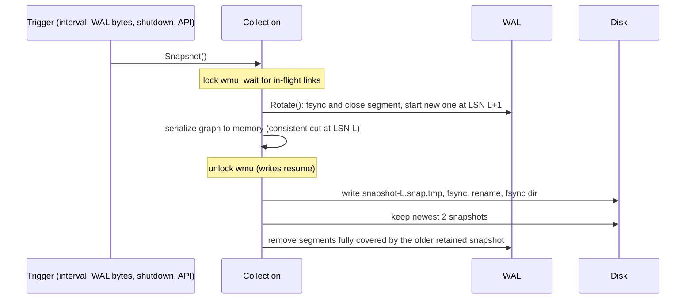
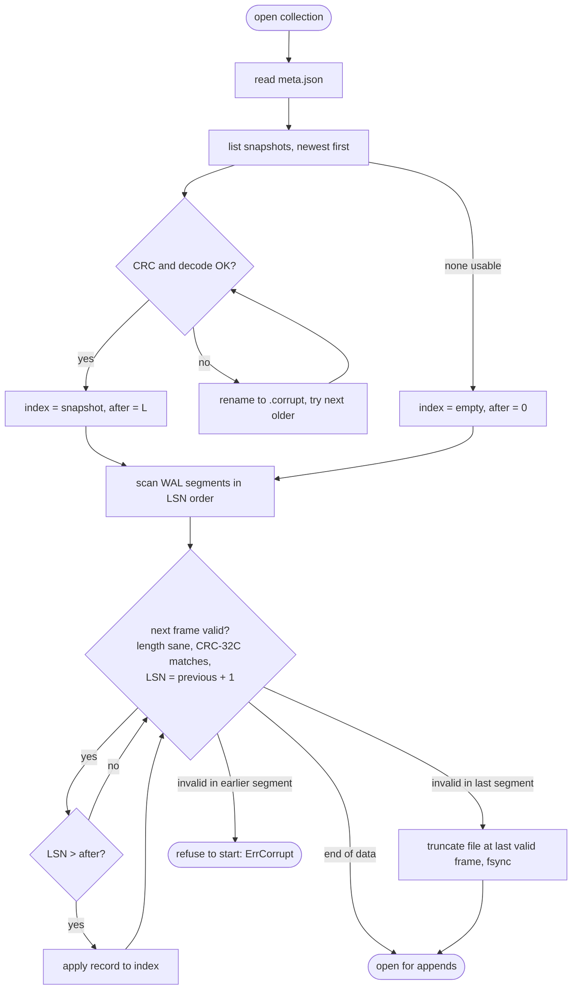

# Architecture

vectordb-go is a single-process server. Each collection is an in-memory HNSW
graph made durable by its own write-ahead log (WAL) and periodic snapshots.

<p align="center">
  
</p>

<sub>Legend: amber = entry points and external systems, indigo = core logic, green = data and state, blue = validation and control, grey = observability and outputs.</sub>

The diagram source is [architecture/architecture.mmd](architecture/architecture.mmd).

## Packages

| Package | Responsibility |
|---|---|
| `internal/hnsw` | The graph: insert, search, tombstones, binary encoding. No I/O. |
| `internal/wal` | Segmented append-only log with CRC-32C framing, fsync policies, group commit, torn-tail recovery. Knows nothing about vectors. |
| `internal/db` | Collections: ties one index to one log, record encoding, snapshots, recovery, background snapshot policy, data-directory lock. |
| `internal/server` | HTTP routing, JSON validation, error mapping, Prometheus metrics. |
| `internal/cli` | `serve`, `bench` and `load` commands, graceful shutdown. |
| `internal/dataset` | Deterministic synthetic data, fvecs/ivecs I/O, exact ground truth. |

## Write path

An upsert is acknowledged only after its batch is in the log (and fsynced
under the default `always` policy) and linked into the graph.

```mermaid
sequenceDiagram
    participant C as Client
    participant H as HTTP handler
    participant Col as Collection
    participant W as WAL
    participant I as HNSW index

    C->>H: POST /v1/collections/{name}/upsert
    H->>Col: Upsert(batch)
    Col->>Col: validate ids, dims, NaN/Inf; dedupe batch
    Note over Col: lock wmu (write order = log order)
    Col->>W: Write(record) one write(2), LSN n
    Col->>I: Allocate nodes, update id map, tombstone old versions
    Note over Col: unlock wmu
    Col->>W: WaitDurable(n) (group commit: one fsync covers many writers)
    Col->>I: Link nodes into graph (parallel for a batch)
    Col-->>H: LSN n
    H-->>C: 200 {"upserted": k, "lsn": n}
```

Key points:

- **Log before index.** A record reaches the log before any in-memory state
  that a search can observe. Allocated nodes are unreachable until they are
  linked, and linking happens after `WaitDurable`, so under the `always`
  policy a search never returns a vector that could be lost in a crash.
  (`GET /vectors/{id}` reads the id map, which is updated slightly earlier, so
  it can observe a vector a few milliseconds before its fsync completes.)
- **One write per record.** The frame (length, checksum, payload) is written
  with a single `write(2)`. After it returns, the record survives a process
  crash because it is in the OS page cache; `fsync` is what makes it survive
  power loss.
- **Ordering under `wmu`, cost outside it.** Only the cheap steps (log write,
  id allocation, id map update) run under the collection write mutex. The
  fsync wait and graph linking, which dominate cost, run outside it, so
  concurrent requests overlap.
- **Deletes** hold `wmu` through their fsync. They must apply in log order
  relative to upserts of the same id, and they are rare enough that sharing
  fsyncs is not worth extra bookkeeping.
- **fsync failure** puts the collection into a failed state that rejects
  further writes until restart. After a failed fsync the kernel may have
  dropped dirty pages, so the only trustworthy state is what recovery reads
  back from disk.

## Snapshot path



Writes pause only while the graph is copied into a buffer, not while it is
written to disk. Searches never pause.

## Recovery path



- A bad frame at the end of the **last** segment is the signature of a crash
  during `write(2)`: the record was never acknowledged, so it is dropped and
  the file truncated back to the last good frame.
- A bad frame in an **earlier** segment means data that had been fsynced and
  rotated is damaged. Recovery refuses to start rather than silently losing
  acknowledged writes.
- A gap between segment names (a missing file) is also an error.
- Two snapshots are retained and the log is kept back to the older one, so a
  damaged newest snapshot falls back to the previous one plus replay.

## On-disk layout

```
<data-dir>/
  LOCK                                  flock held while the server runs
  collections/
    <name>/
      meta.json                         dim, metric, M, efConstruction
      snapshot-00000000000000000412.snap
      snapshot-00000000000000000873.snap
      wal/
        wal-00000000000000000413.log    records 413..873
        wal-00000000000000000874.log    active segment
```

Snapshot file: `"VDBSNAP1" | lsn u64 | hnsw encoding | crc32c u32`. The HNSW
encoding stores the configuration, entry point, and for every node its key,
level, tombstone flag, vector and adjacency lists, so loading a snapshot does
not rebuild the graph.

## Concurrency inside the index

See [ADR 0001](adr/0001-locking-strategy.md). In short: nodes live in
1024-node chunks whose table is published with an atomic pointer; each node
has its own `sync.RWMutex` that guards only its adjacency lists; vectors are
immutable after allocation; and at most one node lock is held at a time.
